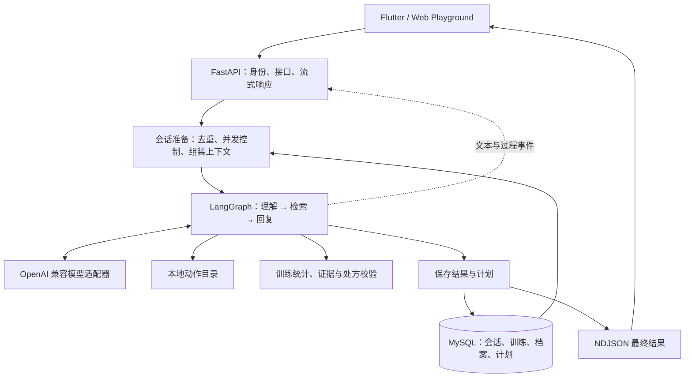

# Q: 我想和你讨论下当前 chatbot 的整体架构，你先梳理下，把现状告诉我

## Answer

Expanded from original query via graph vocabulary: [app, agent, model, catalog, conversation, storage, identity, training, decision, plan, evidence, workout]. Graph BFS used as navigation; current source was verified because raw graph contains unresolved/inferred edges.

我按当前 `fitness-bot` 工作区的源码核对了一遍。**它现在是一个 Python 单体服务，内部由聊天编排、动作目录、训练决策规则和持久化状态四部分组成。产品能力已经覆盖“对话 → 分析训练 → 提出计划 → 用户确认与反馈”。**

整体结构可以这样看：

从代码职责看，主要是这几块：

| 部分 | 当前职责 | 主要入口 |
|---|---|---|
| HTTP 与应用装配 | 初始化数据库、目录、模型；身份解析；聊天、历史、图片和训练接口 | [app.py](/Users/jiakaixiao/Projects/ios-apps/fitness-bot/src/fitness_bot/app.py:36) |
| 对话编排 | 执行三个固定节点，在节点内部处理不同业务分支 | [agent.py](/Users/jiakaixiao/Projects/ios-apps/fitness-bot/src/fitness_bot/agent.py:42) |
| 模型适配 | 意图提取、结构化草案、多模态输入、文本流式生成 | [model.py](/Users/jiakaixiao/Projects/ios-apps/fitness-bot/src/fitness_bot/model.py:49) |
| 动作目录 | 加载和校验本地动作数据，按名称、别名、部位、器械、肌群检索 | [catalog.py](/Users/jiakaixiao/Projects/ios-apps/fitness-bot/src/fitness_bot/catalog.py:41) |
| 训练决策 | 计算历史事实、验证证据、检查动作和处方、计算时间预算 | [training_decision.py](/Users/jiakaixiao/Projects/ios-apps/fitness-bot/src/fitness_bot/training_decision.py:159) |
| 状态保存 | 会话与请求、训练快照、用户档案、计划版本及采用／执行事件 | [storage.py](/Users/jiakaixiao/Projects/ios-apps/fitness-bot/src/fitness_bot/storage.py:111)、[training_storage.py](/Users/jiakaixiao/Projects/ios-apps/fitness-bot/src/fitness_bot/training_storage.py:12) |

一次聊天请求的实际过程是：

1. **先确定身份并准备本轮状态。** 检查图片归属、请求 ID 和会话归属；同一会话同时只能生成一轮，已完成的重复请求直接重放结果。
2. **服务端组装上下文。** 恢复最近 15 个成功对话轮次、此前动作卡、最近 30 次已完成训练摘要、完整日期窗口复盘、用户档案和近期计划。客户端传来的历史及服务端所属数据会被覆盖。
3. **模型判断本轮意图。** 输出 `SearchPlan`，决定是聊天、搜索、推荐、复盘还是整次计划，并提取条件。模型也可以提取本轮临时训练条件；这里的合并不会自动持久修改用户档案。
4. **按意图生成并校验结果，最后保存。** 普通文字可以边生成边返回；`done` 一定在数据库提交后发送。完整训练计划的正文还会暂存到计划校验、提交成功之后再发出。[请求处理源码](/Users/jiakaixiao/Projects/ios-apps/fitness-bot/src/fitness_bot/app.py:210)

这五种意图目前的实现差异很大：

| 意图 | 当前处理方式 |
|---|---|
| 普通聊天 `chat` | 意图识别后，结合已有上下文流式回答；跳过动作检索 |
| 动作搜索 `search` | 模型提取检索条件 → 本地目录筛选 → 最多 2 张真实动作卡 → 文本解释 |
| 动作推荐 `recommendation` | 检索并排除当前训练已有动作、筛器械 → 截取最多 3 个候选 → 模型给结构化组次建议 → 校验 → 文本解释 |
| 训练复盘 `review` | 后端计算日期窗口事实 → 模型输出引用事实的解释 → 校验引用和正文 → 程序渲染结果 |
| 整次计划 `session_plan` | 检查目标、经验、时间、器械、当前状态 → 模型生成结构化草案 → 后端检查并计算 → 保存计划；条件不足时返回待完善预览 |

因此，**LangGraph 目前承担的是固定流程编排**：`understand → retrieve → respond`，没有图上的循环规划或按工具结果反复决策。主要业务复杂度集中在节点内部。一般聊天／搜索通常需要两阶段模型调用；结构化动作推荐通常需要三阶段，未计重试。各阶段使用同一套模型配置，决策阶段提高了输出长度上限。

**数据和“记忆”的现状也很明确：**

- MySQL 是服务端会话、用户档案、计划及训练备份的持久存储。LangGraph 本身没有配置持久化 checkpointer。
- 对话记忆采用“数据库恢复最近若干轮”，目前没有看到长期对话摘要或语义记忆召回。
- 普通聊天的训练摘要限最近 30 次；复盘另外按完整日期窗口统计，默认最近 7 天与此前 21 天对照。这两份资料并存。
- 动作库是随包发布的 1,324 条数据。搜索使用字符串匹配与字段过滤；向量 RAG 尚未启用。整次计划会把按器械筛选的动作摘要提供给模型选择。
- 用户上传图片放在本地文件目录，数据库保存归属和轮次关联；同源 Web Playground 随 FastAPI 一起提供。

**训练决策里，模型和程序各自承担不同责任。** 模型提出主题、解释、动作组合和处方草案；程序计算训练事实，检查真实动作 ID、器械条件、组次类型、负重依据、动作顺序和总时长。时间不足时会移除低优先级项目。历史负重和加量还需要用户确认过的可比记录，并在计划提交时重新核验证据。[证据检查](/Users/jiakaixiao/Projects/ios-apps/fitness-bot/src/fitness_bot/training_evidence.py:212)

计划保存后，有 `proposed → accepted → executed` 等状态，以及跳过、反馈和后继版本。**接受计划与实际完成训练分开记录**；执行关联指向已经上传的训练快照。后端聊天不会直接修改用户的实际训练记录。[计划状态逻辑](/Users/jiakaixiao/Projects/ios-apps/fitness-bot/src/fitness_bot/training_storage.py:217)

我认为目前最值得讨论的架构现状有四点：

- **业务已经明显超过最初的动作搜索范围。** `SearchPlan` 虽然仍叫搜索计划，实际已承担整个 chatbot 的意图路由、复盘参数、计划条件和父计划引用。
- **上下文准备与存储层绑定较深。** `ConversationStore.begin_turn()` 同时恢复聊天、读取训练、计算复盘、加载档案和计划。即使本轮只是简单聊天，也会先准备这些资料；这是潜在成本点，尚未做运行时测量。
- **两条推荐路径的候选选择方式不同。** 单动作推荐在模型判断前就截取少量目录结果，模型的选择空间较窄；整次计划则看到按器械筛选的一批动作。前者排序目前主要是名称精确匹配优先、随后按 ID，并没有独立的个性化排序层。[候选选择](/Users/jiakaixiao/Projects/ios-apps/fitness-bot/src/fitness_bot/agent.py:129)
- **训练规则已成为核心业务代码。** Prompt、结构定义、校验函数和渲染逻辑共同决定回答行为。修改一种训练能力时，通常需要同时考虑这些位置；当前模块边界存在，但 `agent.py`、`model.py` 和训练规则之间的联系已经比较紧。

这是当前源码呈现出的架构，包括工作区尚未提交的实现；没有把历史设计计划当作已实现能力，也没有把静态分析当作线上性能结论。

接下来我建议先讨论一个核心问题：**你希望 chatbot 主要承担“训练讨论与解释”，还是把“持续管理用户的训练计划”作为中心职责？** 这个定位会直接影响意图路由、记忆和计划状态应该怎样组织。

## Outcome

- Signal: useful

## Source Nodes

- CompanionAgent
- SearchPlan
- ConversationStore
- OpenAICompanionModel
- Catalog
- TrainingStore